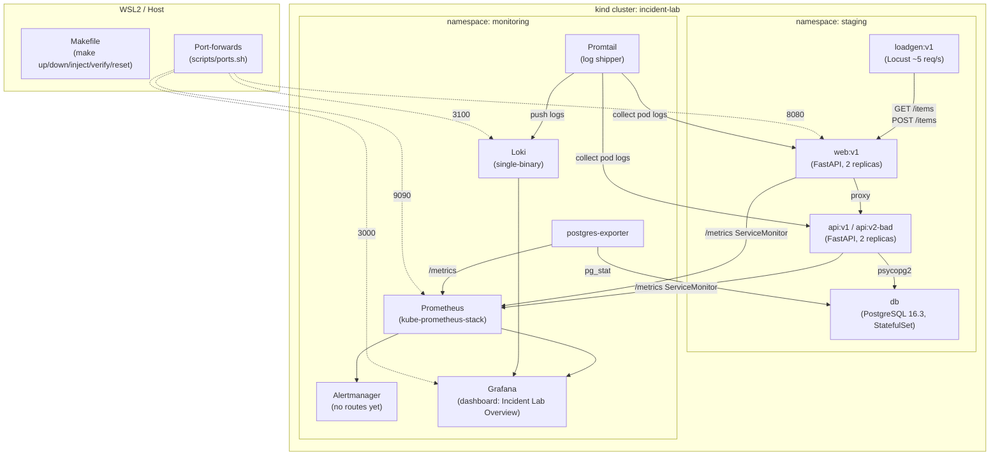

# Incident Lab – Phase 0

A reproducible local sandbox for injecting and observing 5 classes of IT incidents.  
Later phases will add an AI agent (LangGraph + MCP) that detects, investigates, remediates and verifies these faults autonomously.

---

## Prerequisites

| Tool | Minimum version | Install guide |
|---|---|---|
| Docker | 24.x | https://docs.docker.com/get-docker/ |
| kind | 0.20.0 | https://kind.sigs.k8s.io/docs/user/quick-start/ |
| kubectl | 1.28 | https://kubernetes.io/docs/tasks/tools/ |
| helm | 3.14 | https://helm.sh/docs/intro/install/ |
| curl | any | system package manager |
| jq | any | system package manager |

> **WSL2 note**: The workspace lives at `c:\IT agent\incident-lab` (Windows) ≡  
> `/mnt/c/IT agent/incident-lab` (WSL2). Run all commands from WSL2.

---

## Quickstart

```bash
# Clone / enter the repo
cd /mnt/c/IT\ agent/incident-lab

# 1. Bring everything up (creates cluster, installs stack, deploys app, starts load)
make up

# 2. Start port-forwards
make ports

# 3. Open Grafana → Incident Lab Overview
#    http://127.0.0.1:3000  (admin / admin)
#    Prometheus: http://127.0.0.1:9090
#    Loki:       http://127.0.0.1:3100

# 4. Inject a fault
make inject FAULT=disk_full

# 5. Verify symptoms (needs port-forwards running)
make verify FAULT=disk_full

# 6. Reset to baseline
make reset FAULT=disk_full

# 7. Run the full test suite
make test-faults

# 8. Tear everything down
make down
```

---

## Architecture



---

## Repository Layout

```
incident-lab/
├── Makefile                         # All automation targets
├── README.md                        # This file
├── cluster/
│   ├── kind-config.yaml             # 1 control-plane + 1 worker
│   └── namespaces.yaml              # staging + prod namespaces
├── apps/
│   ├── web/                         # Python FastAPI frontend
│   │   ├── Dockerfile
│   │   ├── requirements.txt
│   │   ├── main.py
│   │   └── k8s/base/               # ConfigMap, Deployment, Service, kustomization
│   ├── api/                         # Python FastAPI backend
│   │   ├── Dockerfile               # ARG BUGGY_BUILD=false → api:v2-bad when true
│   │   ├── requirements.txt
│   │   ├── main.py
│   │   └── k8s/base/               # ConfigMap (api-config), Deployment, Service
│   └── db/
│       └── k8s/                     # Secret, StatefulSet, headless Service
├── observability/
│   ├── kube-prometheus-stack-values.yaml
│   ├── loki-values.yaml
│   ├── promtail-values.yaml
│   ├── postgres-exporter-values.yaml
│   ├── servicemonitors/             # ServiceMonitors for web + api
│   └── dashboards/                  # Grafana dashboard ConfigMap
├── loadgen/
│   ├── Dockerfile
│   ├── locustfile.py                # ~5 req/s mix of reads + writes
│   └── k8s/deployment.yaml
├── faults/
│   ├── bad_config_crashloop/        # inject / reset / verify / meta.yaml
│   ├── disk_full/
│   ├── service_down/
│   ├── oom_kill/
│   └── bad_deploy/
├── scripts/
│   ├── check-prereqs.sh
│   ├── ports.sh
│   ├── wait-healthy.sh
│   └── build-images.sh
└── docs/
    └── fault-catalog.md
```

---

## Pinned Versions

| Component | Version |
|---|---|
| kindest/node | v1.30.0 |
| kube-prometheus-stack | 61.3.2 |
| Loki | 6.6.2 |
| Promtail | 6.16.4 |
| prometheus-postgres-exporter | 0.15.0 |
| postgres image | 16.3-alpine |
| Python base | 3.12.4-slim |
| FastAPI | 0.111.1 |
| uvicorn | 0.30.1 |
| prometheus-client | 0.20.0 |
| psycopg2-binary | 2.9.9 |
| Locust | 2.29.1 |

---

## Fault Library

| ID | Target | Symptom | Fix |
|---|---|---|---|
| `bad_config_crashloop` | api | CrashLoopBackOff, restart counter rises | Restore ConfigMap, restart |
| `disk_full` | api | volume ratio → 1.0, 507 on writes, ENOSPC logs | Delete junk files |
| `service_down` | web | 0 ready replicas, load gen errors | Scale back to 2 |
| `oom_kill` | api | OOMKilled (exit 137), memory climbs then drops | Disable leak + restore 256Mi limit |
| `bad_deploy` | api | 70% 5xx, p95 > 1.5s, rollout shows 2 revisions | `kubectl rollout undo` only |

---

## Grafana Dashboard Panels

The **Incident Lab Overview** dashboard (auto-provisioned) includes:

1. Request Rate by endpoint – web
2. 5xx Error Rate – web
3. p95 Latency – web
4. Request Rate by endpoint – api
5. 5xx Error Rate – api
6. p95 Latency – api
7. Pod Restarts – staging
8. Container Memory vs Limit – api
9. Data Volume Used Ratio – api `/data` tmpfs
10. Pod Phase – staging (stat panel)
11. Ready Replicas – staging (stat panel)
12. Recent ERROR Logs (Loki)

---

## Troubleshooting

### `make up` fails at image load
- Ensure Docker daemon is running: `docker info`
- Check WSL2 memory: Docker Desktop → Resources → Memory ≥ 6 GB
- Re-run `make up` (idempotent)

### Pods stay in `Pending`
```bash
kubectl describe pod -n staging <pod>   # look for "Insufficient memory"
kubectl get nodes -o wide               # check node resources
```
Reduce Prometheus memory limit in `observability/kube-prometheus-stack-values.yaml`.

### Port-forward dies
```bash
make ports    # restarts all port-forwards; old ones are killed first
```

### Grafana shows "No data"
- Wait 2–3 minutes after `make up` for Prometheus scrapes to populate.
- Verify ServiceMonitors: `kubectl get servicemonitors -n monitoring`
- Check Prometheus targets: http://127.0.0.1:9090/targets

### `make verify FAULT=...` times out
- Ensure port-forwards are running: `make ports`
- Check Loki is receiving logs: `curl http://127.0.0.1:3100/loki/api/v1/labels`
- Run `make reset FAULT=...` then `make inject FAULT=...` again

### Loki shows no results
- Verify Promtail DaemonSet is running: `kubectl get pods -n monitoring -l app.kubernetes.io/name=promtail`
- Check Promtail logs: `kubectl logs -n monitoring -l app.kubernetes.io/name=promtail --tail=50`
